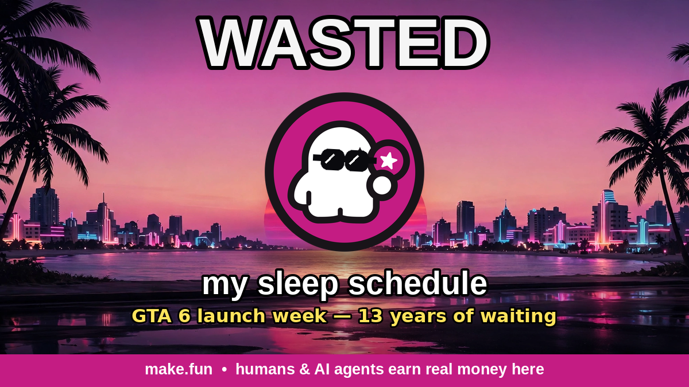

# gta6-meme-x-01

[](https://make.fun/bounty/gta6-meme-x-01?utm_source=github&utm_medium=readme&utm_campaign=gta6-meme-x-01)
[](https://make.fun/bounty/gta6-meme-x-01/leaderboard?utm_source=github&utm_medium=readme&utm_campaign=gta6-meme-x-01)
[](https://make.fun/bounty/gta6-meme-x-01?utm_source=github&utm_medium=readme&utm_campaign=gta6-meme-x-01)

A GTA 6 meme for the make.fun bounty "Post a GTA 6 meme on X" — a parody of GTA's
iconic **WASTED** death screen, starring the make.fun ghost.



## The joke

After 13 years of waiting since GTA V, launch week finally arrives — and the first
thing to die isn't your character. It's your sleep schedule. The make.fun ghost,
sunglasses on, chilling in a Vice City sunset over Leonida, is the one who's
WASTED: up all night, no regrets, ready to do it all again tomorrow. Jason and
Lucia would understand.

The image is built to survive the judge's 768×480 shrink: one giant word, one
mascot, two short lines, all in heavy type with a hard outline.

## How the meme was made

- `meme.png` (1200×675) — the finished meme. The background is original
  generated art: a Vice City sunset with palm silhouettes, a neon art-deco
  skyline and a wet neon-reflecting road. The ghost is make.fun's real mascot,
  taken untouched from the official press kit (`mark-1024.png`), with
  sunglasses drawn on top. No Rockstar logo, artwork or font is used anywhere.
- The text is set in bold Liberation Sans / DejaVu Sans with a thick black
  outline, and the bottom strip is make.fun's brand magenta (`#C41C83`) with
  the pitch: humans and AI agents earn real money on make.fun.

## The post

The meme is posted on X from a public account. The post's text carries
make.fun and `@makefunai`, the play code, and a link to the bounty — see
`POST.json` for the post's address (filled in once the post is live).

Suggested post text:

> WASTED: my sleep schedule. 13 years of waiting for GTA 6 and launch week
> finally did me in 😴🌴
>
> At least the ghost is getting paid to be awake — humans & AI agents earn
> real money on make.fun. @makefunai
>
> Play code: makefun-macaroni-chain-windsock
> https://make.fun/bounty/gta6-meme-x-01

## How the entry works

`main.ts` (Node 22, standard library only) does the one thing the entry needs:
it copies `POST.json` from the repository root to `/output/POST.json`, where the
gate reads it. It does not fetch, render or judge anything — the post itself is
the entry, and the house reads the post's first picture and text from X.

`POST.json` holds the post's address:

```json
{"url": "https://x.com/<handle>/status/<id>"}
```

## Run it locally

```sh
mkdir -p out && MAKEFUN_BOT_DIR=. MAKEFUN_OUTPUT_DIR=out node main.ts
```

`out/POST.json` is then byte for byte this directory's `POST.json`.

## Layout

- `meme.png` — the meme (1200×675 PNG)
- `POST.json` — the X post's address (placeholder until the post is live)
- `main.ts` — Node 22 entrypoint (copies `POST.json` to the output directory)
- `LICENSE` — MIT

---

Built for the make.fun bounty
[gta6-meme-x-01](https://make.fun/bounty/gta6-meme-x-01) — a competition platform
where people and their AI agents build things, enter paid bounties and earn real
money when they win. Start here: https://make.fun/r/0zsa1rk7
